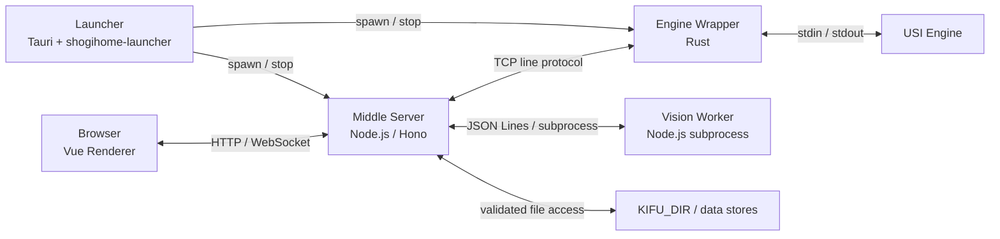
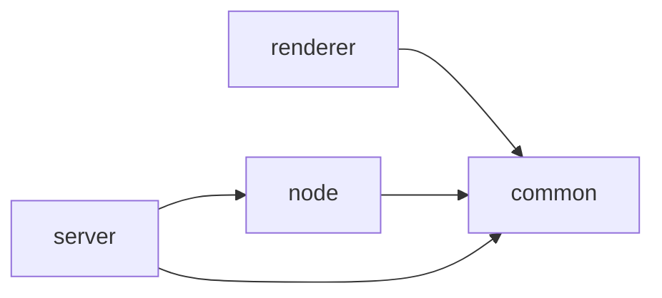

# ShogiHome Lab Architecture

この文書は、ShogiHome Lab の実行時構成、責務の分担、依存・信頼境界、およびモジュールをまたぐ不変条件を示します。各モジュールの設計は [docs/architecture/](docs/architecture/)、自明でない設計判断の理由は [docs/features/](docs/features/) に記載します。実装手順、設定値、schema、UI詳細は扱いません。

## Sources of Truth

設計上の制約はこの文書と各モジュールの設計文書、実行可能な仕様は次のコード・テストを正本とします。両者が矛盾する場合は、古い記述か実装の逸脱かを確認して整合させます。

| 対象                                  | 正本                                                      |
| ------------------------------------- | --------------------------------------------------------- |
| モジュール間の依存制約                | `shogihome/eslint.config.js`                              |
| Browser と Middle Server 間の共有契約 | `shogihome/src/common/` の型・codec と関連テスト          |
| HTTP API                              | `shogihome/src/server/routes/`、共有型、runtime validator |
| 設定名・既定値・制約                  | `shogihome/src/server/config.ts`、各 `.env.example`       |
| DB schema と migration                | `shogihome/src/server/database/` と関連テスト             |
| ビルド・配布物                        | `shogihome/scripts/`、Dockerfile、GitHub Actions workflow |

設計や意図が変わった階層の文書だけを更新し、実装の詳細や値を文書間に複製しません。

## System Context

ShogiHome Lab は、PC 上の USI 将棋エンジンをブラウザーから利用する ShogiHome の派生アプリケーションです。信頼できるプライベートネットワーク内での個人利用を主な運用モデルとし、インターネットへ直接公開するサービスとしては設計していません。

実行時は次の要素から構成されます。

- **Browser**: Vue renderer を実行し、HTTP API と WebSocket を通じて Middle Server を利用します。
- **Middle Server**: Hono API、静的配信、WebSocket session、USI state machine、永続化、および外部プロセス管理を所有します。
- **Engine Wrapper**: 設定された USI engine process を起動し、TCP と stdin/stdout を中継します。Rust 実装が配布の正本です。
- **Launcher**: Tauri shell と headless backend からなる配布版 UI です。Middle Server と Engine Wrapper の起動・停止、設定編集、移行、更新通知を所有します。
- **USI Engine**: YaneuraOu などの外部将棋エンジンです。
- **Vision Worker**: Middle Server が子プロセスとして管理する画像認識 worker です。独立サービスでも Engine Wrapper の一部でもありません。

## Runtime Topology

## Component Responsibilities

| 領域                                                        | 責務                                                                                    |
| ----------------------------------------------------------- | --------------------------------------------------------------------------------------- |
| `shogihome/src/renderer/`                                   | UI、browser-local state、ユーザー操作、HTTP/WebSocket client                            |
| `shogihome/src/common/`                                     | Browser と Server が共有する純粋な型、codec、domain utility                             |
| `shogihome/src/node/`                                       | Node.js runtime に依存する共有 utility                                                  |
| `shogihome/src/server/`                                     | HTTP、WebSocket、engine session、filesystem、database、worker orchestration             |
| `engine-wrapper/wrapper/`                                   | engine 設定、process 起動、TCP/stdio relay、cleanup。USI session state は所有しない     |
| `engine-wrapper/launcher-app/` + `engine-wrapper/launcher/` | native UI と service supervision。UI は process 起動や設定書き込みを backend へ委譲する |
| `engine-wrapper/process/` + `engine-wrapper/env-file/`      | Wrapper と Launcher が共有する process 所有・設定ファイルの境界                         |
| `shogihome/src/server/vision/node-worker/`                  | 画像推論、盤面幾何処理、候補生成、診断 warning                                          |

複雑な状態や business logic は UI component ではなく、renderer store、domain module、または server module が所有します。

## Module Boundaries

`shogihome/eslint.config.js` は主要な依存方向を強制します。

- `common` は `renderer`、`node`、`server` に依存しません。
- `renderer` は `node` または `server` の runtime implementation に依存しません。
- `node` は `renderer` または `server` に依存しません。
- `server` は `renderer` に依存しません。
- `shogihome/src/common/api/rpc.ts` は、Hono の `AppType` を renderer へ共有するための type-only の公式例外です。runtime dependency を追加してはいけません。

## Protocol and Trust Boundaries

境界を越える値は `unknown` として受け取り、既存の decoder、schema、path resolver を通過した後でのみ domain logic へ渡します。

- Browser と Server は共有契約を使い、WebSocket の送受信双方で frame を検証します。HTTP と WebSocket は共通の Host／Origin policy を維持します。
- Session ID やファイルの論理 URI は識別子であり、認証情報や filesystem capability として扱いません。
- Server 側ファイルアクセスは集中化された path boundary を通し、root 外や内部専用の名前空間を公開しません。書き込みは検証済みの保存先へ atomic に公開します。
- 外部棋譜取得は Server が許可する取得先と resource limit に従い、Browser に任意の取得先を選ばせません。
- 外部 process の出力も信頼せず、検証後に公開します。想定外の内部エラー詳細は Server log に留めます。

## State and Lifecycle Invariants

- USI state machine は Middle Server の `shogihome/src/server/engine/session.ts` が一元管理します。Wrapper は process/TCP bridge に留め、探索の競合や停止順序を独自に管理しません。
- 古い探索結果、置換済み接続、取消済み操作は現在の状態を更新しません。Transport の再接続と論理 session の新規作成を区別します。
- 通常対局と棋譜解析の進行・engine resource は Server が所有します。Browser は操作・同期・表示を担当し、接続の寿命を実行状態の寿命と同一視しません。
- 棋譜解析とエンジン同士の対局は、実行を継続したまま画面をデタッチできます。ジョブの発見とアタッチの制御権は Server が所有し、別端末への移譲や Browser の保存情報を実行の再作成と同一視しません。
- 棋譜と時計の巻き戻しは対局 module が一括で確定します。Engine の取消完了を確認せずに巻き戻しを公開しません。
- Process を起動した所有者が終了・失敗時の cleanup を担当し、親 process の終了だけで子孫を回収済みとみなしません。
- Vision は USI session から独立した worker 境界です。Scan 結果は確認用の一時状態であり、ユーザーの確定前に現在の棋譜を変更しません。

## Data Ownership and Persistence

| データ                  | 所有者                            | 性質                                                                         |
| ----------------------- | --------------------------------- | ---------------------------------------------------------------------------- |
| `KIFU_DIR`              | Middle Serverと外部ファイル管理者 | ユーザーが所有する棋譜・定跡・SFENの正本                                     |
| `data/analysis.db`      | Analysis DB module                | Engine解析結果の永続データ                                                   |
| `data/kifu_index.db`    | Kifu index module                 | `KIFU_DIR` から再構築可能な派生index                                         |
| record history / backup | History service                   | Server共有の履歴と復元データ                                                 |
| Book session            | Book session manager              | 保存前の変更を含む有期限の作業状態                                           |
| Analysis job            | Analysis job manager              | 固定入力・進捗・結果・取消を持つ有期限の揮発性状態                           |
| Game session            | Game session manager              | 対局・時計・checkpointを持つ有期限の揮発性状態                               |
| Browser storage         | Renderer                          | タブ固有のアタッチ復帰情報、端末・origin固有の設定・棋譜復元・未確認要求台帳 |

人間参加対局の明示復帰候補も Browser storage が保持し、Server 所有の対局実体やタブ固有のアタッチ状態とは区別します。

Database、filesystem、browser storage は互いに代替可能な正本ではありません。特に kifu index は派生データであり、ユーザーファイルの正本として扱いません。

棋譜局面indexの走査・位置選択規則はCommonのkifu domain utilityが所有し、indexing、検索結果の次手、preview、棋譜openが同じ代表箇所を参照します。検索統計は一覧上限に依存しない検索条件全体の集計をServerのDBが担当し、共有decoderが集計全体との整合性を検証します。詳細は [Storage Architecture](docs/architecture/storage.md) と [Server Kifu Search](docs/features/server-kifu-search.md) を参照してください。

Browser 再接続による作業状態の復元と Server 再起動を越えた永続性は別の保証です。揮発性 session の保持や結果の同期を、ユーザーファイルへの保存として扱いません。

## Deployment Variants

- **開発**: TypeScript entry point と、必要に応じて source の Vision worker を実行します。
- **Portable 配布**: 書き込み可能な portable layout に Launcher、Middle Server、Engine Wrapper を配置し、Launcher が service を管理します。Middle Server の配布物には Vision worker、model、必要な runtime asset を含めます。
- **分割配置**: Docker などで Middle Server を実行し、Engine Wrapper は別プロセスまたは別ホストで動作します。
- **エンジン側ツール**: Wrapper と設定エディタだけをエンジン側ホストに配置し、Middle Server とは独立して管理できます。

起動・配置手順は [README.md](README.md) と [launcher-app README](engine-wrapper/launcher-app/README.md)、分割配布の操作は [engine-tools README](assets/release/README-engine-tools.txt) に記載します。設定は各 `.env.example`、配布構成はビルドスクリプトと release workflow を正本とします。

## Detailed References

- [Remote Engine Architecture](docs/architecture/remote-engine.md)
- [Game Session Architecture](docs/architecture/game-sessions.md)
- [Analysis Job Architecture](docs/architecture/analysis-jobs.md)
- [Launcher / Config Editor Architecture](docs/architecture/launcher.md)
- [Vision Architecture](docs/architecture/vision.md)
- [Storage Architecture](docs/architecture/storage.md)
- [Engine Resource Budget](docs/features/resource-budget.md)
