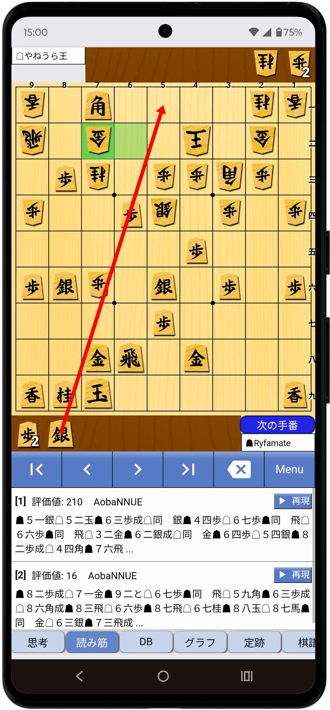
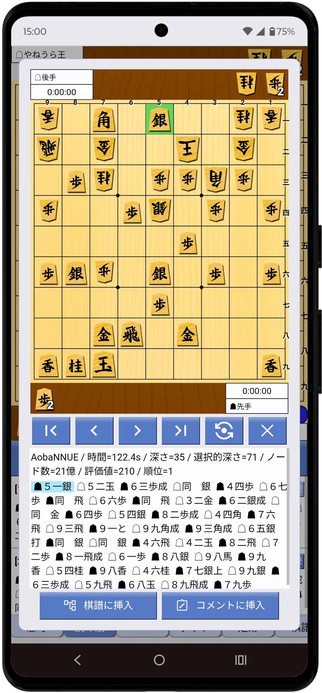
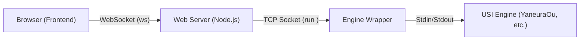

# ShogiHome Lab

[](https://github.com/yoset77/shogihome-lab/actions/workflows/test.yml)

[ShogiHome](https://github.com/sunfish-shogi/shogihome) をフォークし、クライアント・サーバー型にした改造版です。  
USIエンジンの実行や、棋譜・定跡などのデータをサーバーサイドに集約することで、デバイスを選ばずブラウザから将棋研究が行えます。

## 利用にあたって

### 想定する利用環境

本アプリケーションは、**信頼できるプライベートネットワーク（自宅のWi-FiやVPN内など）での個人利用**を想定しています。
ユーザー認証（ログイン）機能はなく、インターネットへの直接公開や、不特定多数での利用は想定していません。
外出先からの利用にはVPN（Tailscale等）をご利用ください。

### 開発について

本フォークで独自に追加・変更したコードは、AIによって生成されています。
作者自身はコードを確認していません。
自動テスト・静的チェックなどを[CI](.github/workflows/test.yml)で行っています。

## スクリーンショット
<table>
  <tr>
    <td align="center">
      
    <br>
     <em>検討画面</em>
    </td>
    <td align="center">
      
    <br>
     <em>PVプレビュー画面</em>
    </td>
  </tr>
</table>

## 主な機能

- **エンジン対局・検討:** PC上のUSIエンジンを、スマホやタブレットのブラウザから利用できます。
- **セッション継続:** ネットワークの一時的な切断が発生しても、サーバー側でエンジンプロセスを一定時間維持し、再接続時に状態を復元します。クライアント側で切断を検知した場合は自動で再接続を試みます。
- **バックグラウンド実行:** 棋譜解析やエンジンどうしの対局をバックグラウンドジョブとして実行できます。別のデバイスからジョブに接続（アタッチ）することも可能です。
- **思考結果データベース:** 検討・対局時の評価値や読み筋をサーバー側（SQLite）に自動蓄積します。思考結果は、別の棋譜やデバイスでその局面を表示した際にも参照できます。
- **サーバー側棋譜・定跡管理:** サーバー上の特定のディレクトリにある棋譜・定跡ファイルを、スマホやタブレットから閲覧・編集することができます。
- **棋譜検索:** サーバー上の棋譜ファイルを、局面やヘッダー情報で検索できます。
- **盤面画像スキャン:** 盤面を撮影して、画像認識によりアプリ内に局面を取り込むことができます。

---

## ディレクトリ構成

本リポジトリは、以下の2つの主要なモジュールで構成されています。

- **`shogihome/`**: Webサーバーおよびフロントエンド（TypeScript/Vue.js）。
- **`engine-wrapper/`**: USIエンジンのプロセス管理とTCP公開を担うエンジンラッパー（Rust）、および設定編集・常駐UIを担うランチャー（Tauri）。

---

## 利用方法

### A. 配布パッケージ（exe）を利用する場合

[Releases](https://github.com/yoset77/shogihome-lab/releases) からWindows用のビルド済みファイルをダウンロードできます。

1. ダウンロードしたファイルを展開し、ルートディレクトリの **`ShogiHomeLab.exe`**（ランチャー）を実行すると、Webサーバーとエンジンラッパーがバックグラウンドで起動します。
2. ランチャーの「エンジン設定」をクリックして、エンジンの登録を行ってください。
3. 表示されているQRコードをスマホで読み取るか、ブラウザで `http://localhost:8140` にアクセスしてください。

詳細なセットアップ手順やトラブルシューティングについては、同梱の **[ユーザーガイド (README.txt)](./assets/release/README.txt)** を参照してください。

### B. ソースコードから実行・ビルドする場合

#### 前提条件
- **Node.js:** v24以上
- **Rust:** stable
- **Git LFS:** 画像認識モデルの取得に必要

#### 1. リポジトリのクローン

```shell
git clone https://github.com/yoset77/shogihome-lab.git
cd shogihome-lab
```

#### 2. Webサーバー (shogihome) のセットアップ

```shell
cd shogihome
npm ci

# 設定ファイルの作成
cp .env.example .env
# .env を編集

# フロントエンドのビルド
npm run build
```

#### 3. エンジンラッパー (engine-wrapper) のセットアップ

エンジンラッパー（Rust）と設定エディタ（Tauri）は Windows / Linux / macOS でビルドできます。GUI の前提環境、単独起動、ランチャーのポータブル配置は **[Launcher / Config editor](engine-wrapper/launcher-app/README.md)** を参照してください。

#### 4. サーバーの起動

**Webサーバー:**
```shell
cd shogihome
npm run server:start
```

**エンジンラッパー:**
```shell
cd engine-wrapper
cargo run --locked -p shogihome-engine-wrapper -- --config-dir .
```

### C. Docker を利用する場合 (Webサーバーのみ)

`shogihome/` (Webサーバー) は Docker コンテナとして実行することも可能です。

```shell
cd shogihome
cp .env.example .env
# .env を編集
docker compose up -d --build
```
※ エンジンラッパー (`engine-wrapper/`) は別途ホストマシン等で起動する必要があります。

---

## アーキテクチャ概要

本アプリケーションは、Webサーバーとエンジンラッパーの役割を分離しています。



- **エンジンラッパー (`engine-wrapper`):**
  - USIエンジン（`YaneuraOu`など）を管理し、TCPソケットで待ち受けます。
  - フロントエンドからのリクエストに応じてエンジンを起動・操作します。

- **Webサーバー (`shogihome`):**
  - ブラウザ向けにShogiHomeのアプリ画面（HTML/JS）を配信します。
  - ブラウザからのWebSocket通信を、TCP通信に変換してエンジンラッパーに中継します。

モジュール境界、信頼境界、Vision worker、データストアを含む詳細は [ARCHITECTURE.md](ARCHITECTURE.md) を参照してください。

---

## ネットワークとセキュリティ

### 実装している対策

本アプリケーションは、以下のセキュリティ対策を実装しています。

- **USIコマンドバリデーション:** サーバー側でコマンドを検証し、コマンドインジェクションを防止しています。
- **オリジン制限:** WebSocket接続と状態を変更するHTTPリクエストでオリジンを検証し、許可されたオリジン以外からの接続・操作を拒否します。ブラウザ以外のAPIクライアントも、unsafe HTTP methodでは許可済みの`Origin`ヘッダーが必要です。
- **HTTPヘッダー保護:** Hono secure-headersを使用し、適切なCSP (Content Security Policy) 等を設定しています。
- **エンジン接続認証:** 環境変数 (`WRAPPER_ACCESS_TOKEN`) を設定することで、Webサーバーからエンジンラッパーへの接続を認証（HMAC-SHA256）します。ラッパーがループバック以外で待ち受ける場合は設定が必須です。

### VPN

VPNを利用することで、外出先からもアクセスすることができます。
以下では、[Tailscale](https://tailscale.com/) を使った手順を説明します。

1.  **VPN接続:** PCとスマホに Tailscale をインストールして、同じアカウントでログインします。
2.  **アクセス:** スマホのブラウザから `http://[PCのTailscale IP]:8140` にアクセスします。

### リバースプロキシ / HTTPS

`tailscale serve` などのリバースプロキシを使うことで、HTTPS化が行えます。
HTTPS化により、以下のことが可能になります。

- クリップボードやカメラなど、Secure Context でのみ利用できる Web API へのアクセス
- PWA としてインストール

※ `localhost` ではHTTPでも Secure Context になるため、上記の機能が利用できます。

---

## コントリビューション

本プロジェクトは個人の趣味として開発されており、メンテナンスのリソースが限られています。
そのため、**Issue や Pull Request をいただいても、対応できない場合や返信が遅れる場合があります。**
あらかじめご了承ください。

---

## 謝辞

- ShogiHome Lab は、[Kubo Ryosuke (sunfish-shogi)](https://github.com/sunfish-shogi) 氏によって開発された [ShogiHome](https://github.com/sunfish-shogi/shogihome) をベースにしたハードフォークです。
  オリジナルの作者に深く感謝いたします。
- `shogihome/src/server/vision/models` のモデルの学習には [ShogiVision](https://github.com/Limuranius/ShogiVision) を使用しています。また、推論パイプラインの実装を参考にしています。

---

## ライセンス

### ShogiHome Lab

[MIT License](LICENSE)

### Icon Images

[/shogihome/public/icon](https://github.com/yoset77/shogihome-lab/tree/main/shogihome/public/icon) 配下のアイコン画像は [Material Icons](https://google.github.io/material-design-icons/) を使用しています。
これには [Apache License 2.0](https://www.apache.org/licenses/LICENSE-2.0.txt) が適用されます。

### Dependencies

本ソフトウェアは多数のオープンソースソフトウェアを使用しています。詳細はアプリ内の「Third Party Libraries」画面でご確認ください。
