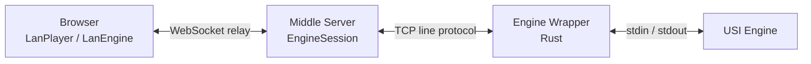

# Remote Engine Architecture

この文書は、Browser、Middle Server、Engine Wrapper、USI Engine 間の責務と、remote engine session が維持する不変条件を説明します。個別frameの完全なschemaやtimeout値は、リンク先のcodec、設定、テストを正本とします。

## Topology

Remote engine は `sessionId` で識別される論理sessionに属します。Middle Server が論理sessionとUSI state machineを所有し、WebSocketはそのsessionへ接続される交換可能なtransportです。

この図は公開relayの経路です。通常対局と棋譜解析ではServer側のownerが内部 `EngineSession` を使用し、Browserは対局／jobのAPIを利用します。通常検討と詰み探索は公開relayに残ります。

## Responsibilities

### Browser

- [`lan_engine.ts`](../../shogihome/src/renderer/network/lan_engine.ts) はWebSocket transport、再接続、送受信frameのcodecを管理します。
- [`lan_player.ts`](../../shogihome/src/renderer/players/lan_player.ts) はrelayをShogiHomeのplayer interfaceへ適合させ、探索の直列化、stop待ち、局面照合、結果通知を管理します。
- Browserが保持する `sessionId` は再接続用の識別子であり、server resourceへの認証情報ではありません。

### Middle Server

- [`websocket.ts`](../../shogihome/src/server/websocket.ts) はHost、Origin、session IDを検証し、socketを論理sessionへ接続します。
- [`sessionManager.ts`](../../shogihome/src/server/engine/sessionManager.ts) は `sessionId` と [`EngineSession`](../../shogihome/src/server/engine/session.ts) の対応を管理します。
- [`session.ts`](../../shogihome/src/server/engine/session.ts) はengine起動、USI handshake、探索状態、stop sequencing、command queue、出力の局面帰属、終了、再接続bufferを所有します。
- [`list.ts`](../../shogihome/src/server/engine/list.ts) は短命なTCP接続でwrapperから設定を取得します。設定の取得はWebSocket送信から独立し、Browserへは公開可能なengine情報だけを返します。取得した文書からリソース予算の設定を解決し、共通のresource managerへ反映します。
- [`transport.ts`](../../shogihome/src/server/engine/transport.ts) は公開relayの受信量と送信滞留を制限します。過負荷のsocketだけを切断し、通常の再接続・cleanupへ収束させます。一覧取得は実行中の取得を共有し、Browser表示だけを短時間cacheします。起動時の予算確認は完了済みcacheを再利用しません。
- [`resources.ts`](../../shogihome/src/server/engine/resources.ts) はグループ予算と予約の共通実装です。relay session、対局、解析ジョブが起動前に設定を解決し、同じsnapshotから所有者単位で予約・起動して終了収束で解放します。予算の有効・無効やグループ削除は、稼働中の予約の寿命を変更しません。
- [`internal.ts`](../../shogihome/src/server/engine/internal.ts) はServer所有sessionの型付きadapterです。USI遷移は `session.ts` を共有し、状態遷移完了後に内部subscriberへ通知します。
- [`auth.ts`](../../shogihome/src/server/engine/auth.ts) は任意設定のwrapper challenge-response認証を実装します。

### Engine Wrapper

Rust 実装 [`wrapper/`](../../engine-wrapper/wrapper/) が唯一の実装であり、配布の正本です。contract suite [`test_wrapper_contract.py`](../../engine-wrapper/tests/test_wrapper_contract.py) が wrapper を検証します。

Wrapperはengine定義・optionを解決し、必要に応じてMiddle Serverを認証してprocessを起動します。TCP/stdio relayとcleanupを所有しますが、USI session stateやBrowserの再接続状態は所有しません。`engines.json` は v2 オブジェクト（`resources` と `engines`）または旧配列ルートを受け入れ、`list` で文書をそのまま返します。リソース予算の解釈と強制はすべてMiddle Serverが行い、Wrapperはエントリー抽出のみを行います。判断理由は [Engine Resource Budget](../features/resource-budget.md) を参照してください。

非ループバックの待受では認証を必須とし、Wrapper自身が実際の待受IPに対して起動条件を検証します。認証情報はengineにも設定エディタのprobeにも継承しません。この境界はengineのsandboxや通信暗号化を提供するものではありません。

Process treeの所有と回収は共有 [`process/`](../../engine-wrapper/process/) に集約します。親processが先に終了しても子孫の所有権を失わず、接続終了やrelay失敗時に回収します。

[`admission.rs`](../../engine-wrapper/wrapper/src/admission.rs) は全TCP接続と初期通信待ちの枠を別々に制限し、超過接続をタスク生成前に拒否します。認証と初期commandには接続受理から共通の絶対期限を適用します。これらはUSI状態とは独立した通信境界の制限です。

設定値と解決規則は [`wrapper/`](../../engine-wrapper/wrapper/) と [`.env.example`](../../engine-wrapper/.env.example) を正本とします。Launcherからの起動・設定編集の境界は [Launcher Architecture](launcher.md) を参照してください。設定エディタはリソース予算を GUI から編集でき、初期値として実行マシンの論理コア数を提案します。

## Lifecycle

Middle Serverがwrapperへの接続からUSI handshake、探索、停止、終了までを管理します。Browserからの検証済みcommandも現在のstate machineに従って送信・待機させ、handshakeを迂回しません。明示的終了、session失効、回復不能なfailureではtransportを終了してprocess cleanupへ収束させます。

明示的終了と接続保護期限切れでは、探索中なら先に `stop` を送り、最終応答に対する既存のAnalysis DB保存処理を終えてからwrapperとのtransportを閉じます。この停止待ちはBrowser切断後も継続し、通常の探索停止とは異なり待機commandや新しい探索を再開しません。停止待ちとtransport終了待ちはそれぞれ有期限であり、最終応答が得られない場合は途中情報を保存せずcleanupへ進みます。終了要求の重複や再接続で期限を延長せず、resource予約はtransportの終了または破棄まで保持します。

### Server-owned Internal Sessions

`GameSession` と `AnalysisJob` はWebSocketを持たない内部 `EngineSession` を所有します。公開relayのsession mapに登録せず、Browserから直接attach／closeできないようにします。内部探索にも既存の探索識別・取消境界とAnalysis DB保存経路を使用します。

Browser切断ではなくownerの完了・取消・失敗がcleanupを決定し、終了応答が来ない場合も期限付きでtransportを破棄します。対局・job側の寿命と同期は [Game Session Architecture](game-sessions.md) と [Analysis Job Architecture](analysis-jobs.md) を参照してください。

## Search and Stop Invariants

- 1つの論理sessionは同時に複数のengine起動を進めません。
- 思考中の局面変更、再探索、option変更などは、必要に応じて先に現在の探索を停止します。
- `bestmove` または `checkmate` を待つ間に届いたcommandは直ちに競合実行せず、state machineが管理します。
- 待機commandを再生するときは、置き換えられた古い局面や探索を再開しないよう整理します。
- Engine outputは対応する `position` を伴い、rendererは現在の探索と一致しない結果を採用しません。
- Stopが回復不能な状態になった場合、未知のengine状態を継続利用せずsessionをresetします。
- 識別付き探索のstop期限はBrowser切断中も進行し、再送や再接続で延長しません。
- 終了処理中の遅延outputでsessionを利用可能状態へ戻しません。

内部状態は [`types.ts`](../../shogihome/src/server/engine/types.ts)、外部へ公開する状態は [`relay_protocol.ts`](../../shogihome/src/common/engine/relay_protocol.ts) が定義します。両者は同一のenumではありません。

## Reconnection

再接続はBrowserとMiddle Server間のWebSocket境界に適用されます。切断したwrapper TCP接続やengine processを透明に再生成する仕組みではありません。

- Browserは一時切断時に再接続し、接続がない間のcommandを保持できます。
- 同じ `sessionId` の再接続は、保護期間内であれば既存の `EngineSession` へ接続します。
- 新しいsocketが接続されると以前のsocketを置換し、置換済みsocketからのcommandを受理しません。
- Middle Serverは切断中の必要な出力を有限のbufferへ保持し、再接続時に現在状態とともに再同期します。
- Rendererは再接続後のserver state、engine ID、terminal resultを照合し、失われたsessionを継続中と誤認しません。
- 保護期間が終了したsessionは削除され、同じIDで後から接続しても新しい未初期化sessionになります。
- 明示的closeでは、可能な範囲でengine終了要求を送ってからBrowser transportを閉じます。

## Protocol Ownership

探索情報のPVは、指し手列に既知の拡張USI終端注記を付加できます。[共通の定義](../../shogihome/src/common/game/usi.ts)と[decoder](../../shogihome/src/common/analysis/types.ts)が受理する範囲を所有し、[表示helper](../../shogihome/src/renderer/helpers/pv.ts)が注記を描画します。注記は指し手や実対局の終局通知ではなく、盤面操作・棋譜の指し手列・session状態遷移には使用しません。

### Identified Search and Cancellation

識別付き探索はsession実体IDと単調増加する探索IDで要求・結果を照合します。Raw USI relayは互換経路であり、識別付き探索の保証と同一視しません。

- 同一要求の再送で再探索せず、古い要求や同じIDの異なる条件は実行しません。
- 通常停止は結果を利用する操作、取消は指定ID以下の探索を無効化する操作です。取消受付と停止完了を区別し、terminal outputを消費してから完了を通知します。
- 同一局面でも別の探索や取消済み探索の出力は採用しません。定跡応答にも取消世代を適用します。
- 最新snapshotから探索・取消完了と直近terminal resultを再同期できます。Snapshotの保持量も有界です。
- Browserは現在のsocketのsnapshotを正本として必要な要求だけを再送し、置換済みsocketやraw stateの遅延再生で上書きしません。

棋譜・時計の巻き戻しはServerの対局moduleが所有し、このmoduleは探索の取消完了だけを保証します。Wrapperへ対局ルールや時計を持ち込みません。巻き戻しの整合性は [Game Session Architecture](game-sessions.md) を参照してください。

### Browser to Middle Server

[`relay_protocol.ts`](../../shogihome/src/common/engine/relay_protocol.ts) が共有型、client/server codec、runtime validation、許可するcontrol commandとUSI commandを所有します。

Wire formatと内部のdiscriminated unionは同一表現ではありません。新しい実装がframeを独自にparseまたは構築せず、共有codecを使用してください。

### Middle Server to Wrapper

TCP protocolはWebSocket relayとは別のline-oriented contractです。次の実装を同期して変更します。

- [`session.ts`](../../shogihome/src/server/engine/session.ts)
- [`list.ts`](../../shogihome/src/server/engine/list.ts)
- [`auth.ts`](../../shogihome/src/server/engine/auth.ts)
- [`wrapper/`](../../engine-wrapper/wrapper/)（Rust）
- [`test_wrapper_contract.py`](../../engine-wrapper/tests/test_wrapper_contract.py)（wrapper の検証）

### Wrapper to USI Engine

Wrapperはprocess起動、option注入、stream relay、cleanupを担当します。USI state machineはMiddle Server、公開relayのrenderer側の局面照合は `lan_player.ts` が担当します。認証、行読込、文字encoding、option schemaの詳細はwrapper実装とcontract suiteを正本とします。
