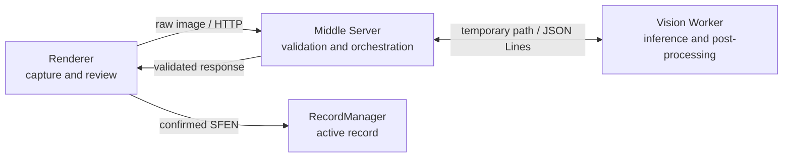

# Vision Architecture

Vision機能は画像から盤面候補を生成し、ユーザーの確認後にSFENを現在の棋譜へ取り込みます。この文書はprocess境界と責務を説明し、model設定やresource limitの具体値はコードと設定を正本とします。

## Boundaries and Ownership

- **Renderer** は画像取得・再encode、手番や視点などの入力、一時的な編集session、最終確認を所有します。
- **Middle Server** はfeature有効性、request validation、一時ファイル、worker supervision、response validation、視点変換を所有します。
- **Vision Worker** は画像decode、盤面幾何処理、ONNX inference、候補生成、score、診断warningを所有します。
- **RecordManager** はアプリケーションの現在局面を所有します。Scan結果だけでは現在の棋譜を変更しません。
- Vision処理はEngine WrapperおよびUSI engine sessionから独立しています。

公開する共有型は [`src/common/vision/types.ts`](../../shogihome/src/common/vision/types.ts) が定義します。Worker内部の中間表現は [`node-worker/types.ts`](../../shogihome/src/server/vision/node-worker/types.ts) に閉じ込めます。

## Request Flow

1. Rendererが画像を再encodeして向き・metadataを正規化し、画像だけでは確定できない入力条件とともに送信します。
2. Middle Serverがrequestを検証し、分離した一時画像をworkerへ渡します。
3. Workerが盤面候補を生成し、Middle ServerがresponseとSFENを検証して公開用の視点変換を適用します。
4. Rendererが候補を一時編集sessionに保持します。ユーザーの確定時だけSFENを再検証してRecordManagerへ反映し、cancelでは一時状態だけを破棄します。

Viewpoint変換は推論workerではなくServer adapterの責務です。詰将棋としての取り込みなど、アプリケーション固有の編集policyはRendererが担当します。

HTTP境界は [`routes/vision.ts`](../../shogihome/src/server/routes/vision.ts)、一時画像とscanのorchestrationは [`command.ts`](../../shogihome/src/server/vision/command.ts)、process transportは [`worker.ts`](../../shogihome/src/server/vision/worker.ts) が所有します。

## Worker Pipeline

[`node-worker/pipeline.ts`](../../shogihome/src/server/vision/node-worker/pipeline.ts) が盤面幾何処理、駒・持ち駒の推論、候補の組み立てを接続します。ONNX sessionは [`node-worker/session.ts`](../../shogihome/src/server/vision/node-worker/session.ts) が所有し、worker processの生存中は再利用します。推論や候補選択の細かな手順はworker実装に閉じ込めます。

## Validation

Model出力を信頼せず、境界ごとに検証します。

- HTTP、画像decode、worker出力の各境界で入力とresource使用量を検証します。Worker transportは既知のrequest IDを持つJSON Linesだけを受理します。
- [`schema.ts`](../../shogihome/src/server/vision/schema.ts) が公開responseとSFENを検証します。Worker内部の中間表現は公開契約へ漏らしません。
- [`transform.ts`](../../shogihome/src/server/vision/transform.ts) が公開fieldの選択と視点変換を一貫して行います。
- Post-processingの制約とwarningは候補品質を改善しますが、完全な合法局面の証明ではありません。最終判断はユーザー確認に委ねます。
- 確定したSFENもRecordManager境界で再度parseします。

## Worker Lifecycle

- Workerは必要時に起動し、model sessionを再利用します。
- Scanは有限の待ち行列で受け付け、worker内部では競合実行させません。
- Timeout、crash、write failure、protocol violationでは影響を受けたrequestを失敗させ、信頼できなくなったworkerを終了します。
- 待機中の後続requestは、新しいworkerを起動して処理を継続できます。
- Browser側のcancelとServer側のworker timeoutは別の境界です。Browser切断後もServerがworker lifecycleを確実に収束させます。
- 一時画像、Rendererのobject URL、編集sessionのBlobは、それぞれの所有者が終了時に解放します。

## Build and Deployment

[`build-server.mjs`](../../shogihome/scripts/build-server.mjs) はMiddle ServerとVision workerを別bundleとして構築し、modelと必要なruntime assetを検証して配置します。

[`build-server-runtime.mjs`](../../shogihome/scripts/build-server-runtime.mjs) は配布用Node runtimeとserver、worker、modelを組み立てます。開発時はbuilt workerがなければsourceを直接実行できますが、配布時の配置はbuild scriptを正本とします。
